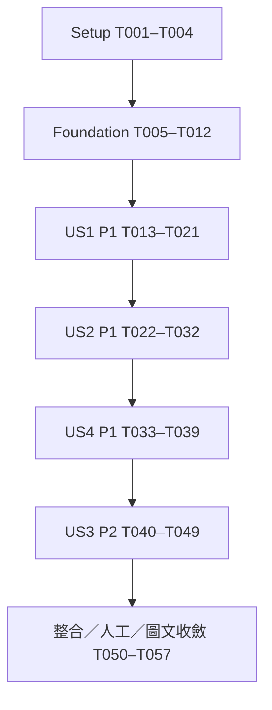

# Tasks: 一次性課堂碼釋放與重用

**Input**: `specs/009-release-classroom-codes/` 的 [spec.md](spec.md)、[plan.md](plan.md)、[research.md](research.md)、[data-model.md](data-model.md)、[contracts/](contracts/) 與 [quickstart.md](quickstart.md)。

**Created**: 2026-11-26；分支 `codex/009-release-classroom-codes`。使用者本次授權產生 tasks，未授權本輪實作。

**Prerequisites**: 使用者已回報C1雙組行為與C2新版圖意皆已確認，T002已完成記錄；姓名／獨立連結未提供。T001執行基線、T003課堂／003具體技術契約與分工、T004實作前問題處理仍按原依賴核對；008待辦保持，不推定產品已實作。

**Tests**: spec 的 US1～US4、R1～R8、SC-001～006 與 plan／憲章 V 已要求可重現自動及人工驗證，因此列測試任務。每階段先寫對應驗收測試、觀察合理失敗，再實作及重驗；既有已成立條件可直接沿用並記錄，不杜撰事前失敗證據。

**Organization**: 依故事優先度 US1(P1)→US2(P1)→US4(P1)→US3(P2)，不重編 spec 的故事號。故事的後端／前端相依如下；每階段有獨立驗收入口，完整009須整合四個故事，不以部分後端視為可交付介面。

## Format: `[ID] [P?] [Story] Description`

所有任務初始未勾選。`[P]` 僅表示同一前置條件完成後、不同檔案的可平行工作，不允許跨 gate、跨故事共用檔搶改或自行傳訊。路徑均相對 repo 根目錄；新檔案是後續預計建立，本輪僅新增本文件並同步狀態說明。

## Phase 1: Setup — 證據、分工與介面

**Purpose**: 保留當前007／008、003及操作者環境，建立可執行任務的前置證據。不初始化新專案或升級套件。

- [X] T001 在 `specs/009-release-classroom-codes/validation.md` 建立009驗證紀錄，記錄分支、HEAD、dirty檔案、feature指向、執行者／日期及證據分類；確認原未追蹤檔保留、008待辦未變，僅沿用Python3.13／Flask／Node／uv.lock，不讀或輸出真憑證。
- [X] T002 在 `specs/009-release-classroom-codes/diagram-review.md` 及 `docs/shared-requirements.md` 記錄使用者於2026-11-26回報「C1 C2皆已確認」：本輪新版圖意及D16→D22行為雙組同步已確認；確認者姓名／獨立連結及實際確認時間未提供，如實註記，不虛構或自行發訊。
- [X] T003 在 `specs/009-release-classroom-codes/contracts/quiz-history.md` 與 `specs/009-release-classroom-codes/contracts/student-entry.md` 記錄課堂／003負責人的介面核對與具名分工，確認共用交易、全部學生結果出口、結算觸發／重送、closed state200／recover409及教師歷史；另於 `specs/009-release-classroom-codes/data-model.md` 核對教師「已失效，可能重用」文案；未確認不得改同學003，共用檔先分配單一負責者。
- [X] T004 依本機speckit-analyze流程檢查 `specs/009-release-classroom-codes/spec.md`、`specs/009-release-classroom-codes/plan.md`、`specs/009-release-classroom-codes/tasks.md` 與三份契約；依使用者「每次分析都要留檔案」指示，把當次發現／建議及歷次修正重驗狀態保存至 `specs/009-release-classroom-codes/analysis.md`，保留歷次證據。分析可寫報告但不自動改其他產物；實際修正另經授權後執行，再重跑分析。完成T001～T003及影響實作的問題後才進Phase2；報告已保存不代表本項全部完成。

## Phase 2: Foundational — 非破壞資料基礎

**Purpose**: 所有故事依賴的schema與隔離驗證材料；僅後續實作階段在臨時DB執行，不接觸操作者DB。

- [X] T005 在 `tests/classroom_009_support.py` 建立臨時007／008 populated fixture與指紋工具，含兩教師／課程、OPEN與CLOSED堂、甲乙組、grant／proof、固定版本、活動／結果及未知回填報告；只用測試secret／密文，覆蓋「原複合 FK 指向該堂組別」與「不因碼重用更新」，並提供僅tests可控制的產碼候選／多連線屏障，禁止正式指定碼開關。
- [X] T006 [P] 在 `tests/integration/test_classroom_code_schema.py` 先定義新DB、populated007／008升級及重啟兩次／init-db重跑的預期：保留全欄位、ID／FK、循環current_activity_id、trigger／index／view、auth_instance UUID及密文；OPEN重碼拒絕、歷史同碼允許、code／id／course_id不可改、CLOSED不可重開；依賴T005。
- [X] T007 [P] 在 `tests/integration/test_classroom_schema_failures.py` 先定義逐步copy／drop／rename／還原／檢查／marker與Google bootstrap故障注入、未知schema／未知依賴物件、FK恢復失敗及雙初始化競爭；預期完整rollback、不服務半完成schema、鎖內重讀版本且失敗後可再啟動；依賴T005。
- [X] T008 在 `src/guided_notes/activities/classroom_schema.sql` 實作新schema，逐欄沿用原PK／FK／NOT NULL／CHECK／default，明確保留「code NOT NULL」「UNIQUE(classroom_id,activity_id)」「classrooms(id,current_activity_id) 複合 FK」「UNIQUE(classroom_id,name)／UNIQUE(classroom_id,id)」，取消code表內UNIQUE、增加 `classrooms_open_code_unique` 的「code WHERE state='OPEN'，全域唯一，CLOSED 不占用」、CLOSED→非CLOSED與改code／id／course_id拒絕trigger；新增 `classroom_schema_versions` 的「version PK、applied_at」，不覆寫user_version或auth_instance。
- [X] T009 在 `src/guided_notes/activities/classroom_migration.py` 實作data-model第1～8步的專用連線升級：交易前FK OFF→BEGIN IMMEDIATE→建新表／逐欄copy／移除舊表／新表改原名／還原依賴→foreign_key_check／integrity_check及指紋比對→marker同交易commit；finally恢復ON並關閉連線；不先rename舊表、不用writable_schema、未知依賴停止，錯誤完整rollback；依賴T006～T008。
- [X] T010 在 `src/guided_notes/db.py` 接線提供服務前的schema辨識／升級／已升級驗證no-op，鎖內重讀狀態避免雙copy；新DB維持core＋Google同交易原子初始化，007／008不重設UUID／密文；一般g.db保持FK ON，禁止把OFF連線流入request；不改002非CLASSROOM_MODE規則；依賴T009。
- [X] T011 在 `tests/integration/test_google_schema_atomicity.py` 與 `tests/integration/test_workspace_007_compatibility.py` 補009初始化相容預期並重驗core／Google故障完整回復，依data-model驗「完全保留，FK／UUID／密文不得因初始化改變」；不得以新空白DB取代populated升級；依賴T010。
- [X] T012 執行T006／T007／T011的隔離驗證，在 `specs/009-release-classroom-codes/validation.md` 逐項記V01／失敗修正重驗、FK恢復與全部歷史指紋；全部通過才解鎖故事階段，不啟動操作者服務或執行真DB遷移。

**Checkpoint**: 新舊schema、故障回復與原資料保留都有證據，所有故事才可開始。

## Phase 3: User Story 1 — 永久關課並讓碼可重用 (Priority: P1)

**Goal**: 有權教師永久關堂、釋放有效占用，新堂可自動抽到原碼；無效／舊碼無有效對應只顯示查無課堂。

**Independent Test**: 在fixture以A／C加入兩組，關閉A、令B抽到C，再重送結束A；A歷史固定、B不變、最多一OPEN。CLI／HTTP可驗，不依賴US3新頁。

### Tests

- [X] T013 [P] [US1] 在 `tests/contract/test_classroom_management.py` 先補建堂／關課／重送／權限契約，涵蓋confirm缺少400、未授權／他教師拒絕、200冪等不改版本／時間、不重transition／結算、無活動／PREPARING／LIVE／已結算堂、單活動結束不釋碼及12次碰撞後503；FR-001～006、009、013、015。
- [X] T014 [P] [US1] 在 `tests/contract/test_classroom_memberships.py` 先補產碼「兩個 A–Z 大寫英文字母加三個 0–9 數字，共 5 碼」、輸入「原始輸入長度最多 32 字元」／「group_name 原始最多80」與非空文字、strip＋upper不移中間空白、同堂trim同名同組；無OPEN回403 JOIN_DENIED且不洩露歷史，失敗不發grant／proof；FR-003、014。
- [X] T015 [P] [US1] 在 `tests/integration/test_classroom_code_lifecycle.py` 先定義A關閉→B同碼新ID的同／跨教師課程情境，核對所有舊組別／membership／活動／結果／回填歸屬不變，重送A不影響B；測試強制候選只在fixture，不要求正式UI指定碼；V03、V08。
- [X] T016 [US1] 在 `src/guided_notes/activities/classroom_routes.py` 更新insert_room，保留make_room_code格式及12候選，conflict target匹配部分索引code＋OPEN條件且只吸收碼衝突，其他約束回復；建堂與有權課程檢查同交易，無候選回503 CLASSROOM_CODE_UNAVAILABLE，不保證耗盡全部碼域。
- [X] T017 [US1] 在 `src/guided_notes/activities/classroom_membership.py` 更新join為寫入鎖內只查code＋OPEN、固定room ID後建組／membership／grant同交易；保留原組別複合FK、proof digest與expires，無有效對應統一JOIN_DENIED，禁止重試重解析到另一堂；依賴T016及T014。
- [X] T018 [US1] 在 `src/guided_notes/activities/classroom_routes.py` 更新close為先驗owner再判狀態，OPEN時未結束活動＋課堂同commit並釋放索引占用；CLOSED重送200不改state_version／closed_at、不transition／結算；enroll只於commit後更新session／cookie；依賴T016～T017。
- [X] T019 [US1] 在 `src/guided_notes/activities/classroom_access.py` 將新不可逆／不可改歸屬約束映射到明確409衝突並保留既有錯誤語意、busy503及完整rollback，未知IntegrityError不得當碼碰撞或假成功；依賴T018。
- [X] T020 [US1] 在 `src/guided_notes/static/classroom.js`、`src/guided_notes/templates/workspace/classroom.html` 及 `src/guided_notes/templates/workspace/classrooms.html` 依T003核定文案區分有效碼／歷史已失效可能重用，教師仍無指定碼或重開入口；保留008導覽、ownership及原活動控制，不改學生獨立頁工作；依賴T018～T019。
- [X] T021 [US1] 執行T013～T015及既有課堂switch中與US1相容案例，在 `specs/009-release-classroom-codes/validation.md` 記V02／V03／V08結果及原歷史比對；確認無有效碼重複、重送不碰B；舊close測試的關課內容／恢復／409預期交T030一併更新與T031重驗，不宣稱此時已全回歸，未執行項如實標示。

**Checkpoint**: US1後端可獨立驗收；尚未US2禁讀及US4競態驗證前，不對外部署為完整009。

## Phase 4: User Story 2 — 關課後停止學生存取 (Priority: P1)

**Goal**: 開放期間恢復原堂／原組；關課後學生內容即使舊資格未過期也拒絕，教師歷史可用。

**Independent Test**: 有效grant／proof直接呼叫room state／results／activity results／recover／submission；OPEN活動結果依D06，CLOSED只最小提示或拒絕。完整視覺結束頁在US3接線。

### Tests

- [X] T022 [P] [US2] 在 `tests/contract/test_classroom_results.py` 先更新原CLOSED恢復204／歷史可讀預期為recover409及內容拒絕，新增closed state最小欄位白名單、room／activity結果無洩漏、OPEN且活動CLOSED的D06／pending仍成立；保留教師原歷史測試，不刪失敗案例；V05／V07。
- [X] T023 [P] [US2] 在 `tests/contract/test_classroom_recovery_009.py` 先定義有效／過期／缺少／其他堂／組別proof、OPEN恢復204與CLOSED409、禁止body指定group_id／group_name、closed零grant／Set-Cookie／session改動、cookie HttpOnly／SameSite=Lax／原path及CSRF／限流情境；V06。
- [X] T024 [P] [US2] 在 `tests/integration/test_classroom_history_009.py` 先定義關堂／重碼後教師原活動、固定版本、已結算快照與未知回填報告仍可讀，未結算RESULT_NOT_READY、學生禁讀且無自動Google寫入；provider僅受控，不視作正式003或真Sheets；V07。
- [X] T025 [US2] 在 `src/guided_notes/activities/classroom_membership.py` 拆固定身份helper及OPEN內容guard，保留原classroom_id／group_id關係，group_for預設檢OPEN；舊「read_only」grant在CLOSED亦拒絕，身份不符先401／403且不洩露課堂存在／狀態；依賴T022～T023。
- [X] T026 [US2] 在 `src/guided_notes/activities/classroom_membership.py` 將recover改為原proof有效且OPEN才發「read_only=0」grant；關課只409不改資格，缺少／失效403、不以碼補資格；保留expires／RECOVERY_SECONDS而不刪歷史紀錄；依賴T025。
- [X] T027 [US2] 在 `src/guided_notes/activities/classroom_routes.py` 接線state於有效原身份且CLOSED直接回200的classroom_id／classroom_state／state_version三欄，不呼叫state_view；recover驗body與CSRF、closed零session寫入；room results經OPEN guard，讀取權限及DTO在同read transaction；教師分支不受OPEN限制；依賴T026。
- [X] T028 [US2] 在 `src/guided_notes/quiz/results_gateway.py` 由T003指定負責人接入學生OPEN guard及同read transaction驗權／組DTO，涵蓋直接activity results與已核對其他出口；偽造teacher header仍驗owner，教師get_ended_snapshot保持CLOSED／settled判斷，不更動排序／結果provider；依賴T027及T003契約確認。
- [X] T029 [US2] 在 `src/guided_notes/activities/submission_context.py` 核對並補受理對原堂OPEN、當前activity LIVE、原group／固定題目版本的檢查與錯誤契約，保留「同一db／transaction」交給ACCEPT_SUBMISSION；涉及 `src/guided_notes/quiz/submission_gateway.py` 的必要接線由T003負責人處理，不覆寫正式003順位／結算；依賴T028。
- [X] T030 [US2] 在 `tests/integration/test_classroom_close.py` 逐項更新closed state不再含activity題目及舊碼新加入409→403的相容預期，補教師結果不被OPEN guard誤擋、身份／角色偽造拒絕；保留既有課堂OPEN下單活動／全文行為；依賴T029。
- [X] T031 [US2] 執行T022～T024、T030及非CLASSROOM_MODE的002／007教師登出隔離回歸，在 `specs/009-release-classroom-codes/validation.md` 記每個直接入口與JSON欄位檢查、V05～V07、未到期資格也拒絕的證據；依賴T029～T030。
- [X] T032 [US2] 依T024、T031證據在 `specs/009-release-classroom-codes/contracts/quiz-history.md` 補實際guard／結果入口／教師快照位置及未完成正式003項目，於 `specs/009-release-classroom-codes/validation.md` 分列受控回填／真正回填；不改001來源或把關課當結算完成。

**Checkpoint**: US2可用HTTP獨立驗收且不依賴新UI；完整學生結束頁需US3，未接線前不稱完整故事交付。

## Phase 5: User Story 4 — 並發仍維持唯一歸屬 (Priority: P1)

**Goal**: R1～R8每種先後順序均可重現，重送／失敗／忙碌不造成錯堂或雙重有效碼。

**Independent Test**: 使用臨時DB、多連線與屏障，控制實際確認順序，不以循序HTTP當並發證據；獨立執行三份race測試並驗資料歸屬。

### Tests

- [X] T033 [P] [US4] 在 `tests/integration/test_classroom_code_races.py` 先定義R1／R3／R7：雙建立同碼、關堂至重配空窗、A重送與B占碼並發；對比每次成功commit後有效索引與原歷史，含busy及12候選失敗不得留空殼堂；依賴T021、T031。
- [X] T034 [P] [US4] 在 `tests/integration/test_classroom_join_races.py` 先定義R2／R4／R5／R6：加入先後、解析固定目標不得轉投、關課中故障rollback；用屏障證明生產交易解析後其他writer不能插入關課，不為測試新增預解析API；驗零部分membership／grant；依賴T021、T031。
- [X] T035 [P] [US4] 在 `tests/integration/test_classroom_submission_races_009.py` 先定義R8及結果read／close先後，測試受理callback在同交易、close先拒絕／accept先保留、結果DTO與驗權同交易；關課commit後新開始讀取必拒絕，關課前合法快照晚回不當成新存取，其畫面拒絕套用另由T048驗證；受控與正式003執行各有記錄，不以fake當真排名；依賴T029、T032及T003已核定契約。
- [X] T036 [US4] 依T033失敗證據在 `src/guided_notes/activities/classroom_routes.py` 修正剩餘分配／關課鎖定及冪等邊界，只於尚未解析目標的取得寫鎖階段做bounded busy retry，關堂失敗完整rollback，禁止依碼更新別堂；沒有新缺陷則記證據不重寫；依賴T033～T035。
- [X] T037 [US4] 依T034失敗證據在 `src/guided_notes/activities/classroom_membership.py` 補固定目標／原組別的最終確認與失敗回復，加入確認失敗不得同請求重新解析到B；不新增以code恢復的fallback；依賴T036。
- [X] T038 [US4] 依T035失敗證據在 `src/guided_notes/activities/submission_context.py` 及 `src/guided_notes/quiz/results_gateway.py` 由T003負責人補受理／結果與關課交易邊界，若需正式003改動先記錄核對再執行；不更動順位／結算規則，不自行增加worker；依賴T037。
- [X] T039 [US4] 執行T033～T035及受影響測試，在 `specs/009-release-classroom-codes/validation.md` 按R1～R8逐列記writer順序、預期／實際、成功／拒絕及歸屬，另列正式003尚未驗的項目；V04完整受控證據通過才進US3整合。

**Checkpoint**: 交易安全可單獨驗收；正式003整合尚未做時不得勾選T051。

## Phase 6: User Story 3 — 手動加入同碼的新課堂與獨立學生頁 (Priority: P2)

**Goal**: 獨立加入頁→固定堂頁；關課只顯示結束及按鈕，手動重新輸入碼／組別才加入新堂，無常駐登入提示。

**Independent Test**: 開A舊頁、B重用碼；只持A資格無B權；獨立頁明確輸入後才進B，A舊頁／晚回不變B，結束頁不可被OPEN或舊結果覆蓋。

### Tests

- [X] T040 [P] [US3] 在 `tests/contract/test_student_entry_009.py` 先定義GET /student純加入、GET /student/classrooms/{id}無內容shell、首頁學生入口及無資格不SSR題目／結果，teacher／002路由仍相容；加入失敗不導頁、成功用伺服器ID，所有受保護HTML／JSON no-store；依賴T039。
- [X] T041 [P] [US3] 在 `tests/student-entry-009.test.cjs` 先定義成功201才導航、pending防重送、錯誤／CSRF／限流／服務失敗留原頁可重試、零背景重加、零Google登入與proof／grant不入storage／DOM／URL；依賴T039。
- [X] T042 [P] [US3] 在 `tests/student-room-009.test.cjs` 先定義固定room／activity、OPEN恢復、CLOSED terminal、清題目／草稿／結果、按鈕才返回、網路錯誤與AUTH_REQUIRED分離、pageshow／pagehide／BFCache及舊回應拒絕；依賴T039。
- [X] T043 [US3] 在 `src/guided_notes/templates/activities/student_join.html`、`src/guided_notes/templates/activities/student_room.html` 與 `src/guided_notes/static/student-classroom.css` 建立獨立表單／無內容shell／結束區，碼maxlength32、組名maxlength80、兩者required；提供文字label、pending／error／status、焦點與窄螢幕樣式，不常駐登入提示，teacher樣式不受影響；依賴T040～T042。
- [X] T044 [US3] 在 `src/guided_notes/__init__.py` 接線學生兩頁路由，CLASSROOM_MODE固定URL只帶內部堂ID並不授權；維持非課堂002及007首頁／教師路由，CSRF與no-store保持；內部ID不要求使用者輸入；依賴T043。
- [X] T045 [US3] 在 `src/guided_notes/static/student-entry.js` 實作獨立加入送出與錯誤復原，碼＋組別仍經原POST、201後導航回傳room ID，JOIN_DENIED顯示「查無此課堂」，不預送舊碼／組別、不改教師資格；依賴T044及T041。
- [X] T046 [US3] 在 `src/guided_notes/static/student-room.js` 實作固定堂頁狀態機與約1秒輪詢，沿用單活動／全文／D06及整組提交；room／activity／generation／version檢查、CLOSED terminal清內容＋取消舊fetch、不再讀結果或恢復；grant過期以原proof明確恢復一次，closed409只顯示結束，按加入其他課堂才回/student；不以localStorage選堂；依賴T045及T042。
- [X] T047 [US3] 在 `src/guided_notes/static/classroom.js` 及 `src/guided_notes/templates/activities/classroom.html` 移除學生舊混合加入／關課結果恢復分支或使其不再被學生路由使用，移除舊「關課後可恢復結果」提示；原教師固定course／room、列表請求序號、008導航及登入不變，不改002學生activity-sync.js；依賴T046。
- [X] T048 [US3] 在 `tests/student-room-009.test.cjs` 補多分頁新加入B／舊A資格不符、closed恢復晚回零session更新、活動切換舊結果、關課前已同交易合法驗OPEN的資料在前端確認CLOSED之後回來及返回舊頁測試，預期清內容後絕不再顯示；於 `src/guided_notes/static/student-room.js` 依失敗修正失效／取消／隱藏內容，禁止自動跳新堂，不能聲稱收回先前已閱讀資料；依賴T047。
- [X] T049 [US3] 執行T040～T042、T048及既有classroom-sync／recovery／preview與workspace前端回歸，在 `specs/009-release-classroom-codes/validation.md` 記V06／V09、常駐登入表單數0、固定舊頁及晚回證據；DOM模擬不替代真人排版／鍵盤驗收。

**Checkpoint**: 四故事完成受控整合；正式003及教師加兩組學生人工結果仍由最終階段追蹤。

## Phase 7: Polish & Cross-Cutting Concerns

**Purpose**: 跨模組、真人、圖文程式一致性與交付證據；全部前階段依賴完成後進行，不代勾008或其他功能任務。

- [X] T050 執行 `specs/009-release-classroom-codes/quickstart.md` 的V01～V09及全Python／Node必要回歸，於 `specs/009-release-classroom-codes/validation.md` 記指令、版本、預期／實際與修正重驗，確認002、005／006全文、007身份、008導覽／匯入／講義移除均相容；受影響檢查通過後才擴大測試，不以舊測試數當本版證據。
- [ ] T051 與003負責人用正式ACCEPT_SUBMISSION／GET_SETTLED_RESULTS接線驗證受理截止、整組提交、順位／結算、關課重送及學生禁讀／教師原結果，在 `specs/009-release-classroom-codes/contracts/quiz-history.md` 與 `specs/009-release-classroom-codes/validation.md` 記雙方版本／操作者／案例；正式服務未到位則保留未執行，不做假勝組或覆寫同學程式。
- [ ] T052 由教師與至少甲乙兩組依 `specs/009-release-classroom-codes/quickstart.md` 人工驗收獨立頁、加入／失敗、開放恢復、課堂仍OPEN時活動結果、關課5秒目標／禁讀、按鈕返回、舊頁隔離、多分頁、Tab／Enter與390×844／桌面布局，在 `specs/009-release-classroom-codes/validation.md` 記實際計時與去機敏證據；依SC-005分列真人手動加入新堂與T015／T033～T039受控同碼隔離證據，不要求真實隨機抽同碼、不新增正式指定碼開關、不操作未授權真Sheets寫回。
- [X] T053 依已驗結果更新 `README.md`、`docs/shared-requirements.md`、`specs/009-release-classroom-codes/quickstart.md` 與 `specs/009-release-classroom-codes/plan.md`，列部署前停舊服務／備份／沿用原DB與key、schema失敗停止、無法直接回退永久UNIQUE及新舊學生規則；未驗或跨組未確認清楚標示，不改008任務狀態。
- [X] T054 核對 `diagrams/009-component.puml`、`diagrams/009-class.puml`、`diagrams/009-sequence.puml` 與實作責任／FK／索引／端點／交易分支，同步必要差異後以既有Java PlantUML CLI重渲染全部puml至同目錄PNG，逐張檢視並在 `specs/009-release-classroom-codes/diagram-review.md` 記命令／退出碼／圖意核對者，不把AI檢視當同學互審。
- [ ] T055 依本機speckit-converge核對 `specs/009-release-classroom-codes/spec.md`、`specs/009-release-classroom-codes/plan.md`、`specs/009-release-classroom-codes/tasks.md` 與實作，把未完成工作附加至tasks並完成／重驗；人工或正式003未做如實保留，不為收尾代勾；於 `specs/009-release-classroom-codes/validation.md` 保留收斂證據。
- [X] T056 再執行本機speckit-analyze，在 `specs/009-release-classroom-codes/analysis.md` 留存當次跨規格／圖／契約／任務報告與歷次問題狀態，尤其D16舊歷史授權與D22新禁讀差異、正式003／跨組確認及T055新增任務；分析期間只寫報告，其他產物修正另經授權後執行並重驗。合併前仍須完整通過，不由本任務自動合併。
- [X] T057 在 `specs/009-release-classroom-codes/validation.md` 完成最終檔案範圍、git diff --check、去機敏與證據完整性檢查，逐項區分受控／正式003／真人／真Google，記剩餘限制及原未追蹤檔保留；未另獲使用者授權前不commit／push／合併PR、不改真DB／OAuth／key，不能因tasks勾完而宣稱未做的人工項完成。

## Dependencies & Execution Order

### Phase Dependencies

Setup T002確認記錄已完成；T001→T003→T004仍是實作前準備，003具體介面／分工未核對前不改同學共用程式。Foundation T005→{T006,T007}→T008→T009→T010→T011→T012，之後才進故事。

### User Story Dependencies

- US1只需Foundation即可用HTTP獨立測試。
- US2依US1關課／建堂結果及固定資格，驗收本身可直接用HTTP，不依賴新頁。
- US4依US1／US2後端，驗完整鎖定／權限及003邊界；不依賴新頁，需T003已核定的正式介面。
- US3依US1／US2 API及US4競態保證，把學生獨立頁、終止頁與舊頁隔離接上；完整US2視覺情境到此才成立。
- 每階段測試先行，來源檔及共用測試修改循序；任何新失敗先修正再往下。T051正式003、T052真人不能以其他綠燈替代。若未具備外部條件，保持對應任務未完成，能做的獨立文件／隔離工作繼續。

### Parallel Opportunities / Examples

全部[P]任務在共同前置完成後才可同時執行；本文件僅規劃機會，不是授權另開聊天室或發訊。

| 階段／故事 | 可平行範例 | 共同前置／結束界線 |
| --- | --- | --- |
| Foundation | T006 schema正常路徑、T007故障路徑 | T005 fixture已完成；兩個不同測試檔，實作從T008循序。 |
| US1 | T013管理契約、T014加入契約、T015歷史整合 | T012通過；三個不同檔；classroom_routes後續T016／018單人循序。 |
| US2 | T022結果契約、T023恢復契約、T024教師歷史 | T021通過；membership T025／026同檔循序；quiz改動依T003分工。 |
| US4 | T033碼競態、T034加入競態、T035受理競態 | T021／T031與T003契約就緒；使用各自臨時DB，不共用連線或正式資料。 |
| US3 | T040頁面契約、T041加入JS、T042課堂JS | T039通過；新來源從T043整合，T048與T042同檔不可同時編輯。 |

不把同一 `classroom_routes.py`、`classroom_membership.py`、`db.py`、`quiz/results_gateway.py` 或同一驗證紀錄的多項任務標為可同時改檔；故事之間按上圖順序，沒有宣稱全部故事可平行。

## Implementation Strategy

### MVP First

最小**技術驗收切片**為Phase1＋Phase2＋US1：可以在隔離HTTP驗證關課／碼重用，不能作完整009部署。學生關課禁讀與交易安全屬必要要求，對外候選版至少完成US2／US4，且使用者要求的獨立頁必須完成US3後一起交付，不能為省工略過。

### Incremental Delivery

依Foundation→US1→US2→US4→US3逐段寫驗收、見合理失敗、實作、重驗、記錄；任何階段的安全或資料保留失敗不進下一階段。T050～T057完成正式整合／人工／圖文一致性後才可宣稱完整功能；沒有自動部署、遷移真DB或Git提交步驟。

### Coverage / Independent Validation

| 規格要求 | 主要任務 | quickstart／成功條件 |
| --- | --- | --- |
| FR-001、002、004～006 | T006～T021、T033、T036、T039 | V01／V03／V04／V08；SC-001 |
| FR-003、014、015 | T014、T016～T017、T021、T045 | V02／V03；SC-001～002 |
| FR-007～009 | T022～T031、T040～T049 | V05／V06／V08；SC-002～003 |
| FR-010～011 | T005～T012、T015、T024、T028、T032、T051 | V01／V07；SC-003 |
| FR-012～013 | T033～T039、T042、T046～T048 | V04／V09；SC-004 |
| FR-016～018、017a | T040～T049、T052 | V06／V09；SC-005～006 |
| R1～R8全部 | T033～T039、T051 | V04，正式／受控分列 |

### Task Count / Generation Validation

共57項：Setup4、Foundation8、US1 9、US2 11、US4 7、US3 10、Polish8；[P]共14項。全部保持未勾選，IDs T001～T057連續；故事階段均含對應[USn]，其他階段無故事標籤，每項有明確檔案路徑。生成檢查只驗本文件格式、依賴／追溯與連結，不是產品驗證；無extensions.yml，before／after tasks無hook。

## Notes

本輪產生tasks而未執行任何任務，既有產品測試及008人工任務不代勾。本地`.specify/feature.json`仍指009、分支不變；原未追蹤檔保留，沒有commit／push。下一流程是speckit-analyze，並非本文件生成後自動實作。

本輪實際生成檢查：57個連續ID／14個[P]、全部未勾選、故事標籤／檔案路徑及功能目錄Markdown連結／行尾空白均通過，git diff --check通過；前後皆無extensions.yml，無hook可執行。收尾時發現 `specs/008-teacher-course-workspace/validation.md` 在共用工作區另增5行人工複驗紀錄，本輪未寫入該檔，已保留，不回復或代替其確認。

2026-11-26最新任務狀態：使用者回報C1／C2已確認，T002因記錄已完成而勾選；其餘56項仍未完成。前文「全部未勾選」屬產生當下紀錄。D1僅調整spec FR-016／018責任，不改任務數／編號／依賴；沒有執行實作。

實作階段前置更新：使用者指定先檢查同學003 PR再開始，已完成PR9固定head程式／契約核對及隔離14測試，T003按此指示完成，證據見pr9-review.md；沒有虛構同學逐條簽核。T004依analysis第3輪及本次PR差異重核完成；尚未實作，T005起待做。

## Phase 8: Convergence

2026-11-26：Codex依speckit-converge核對19個FR／6個SC、四故事與R1～R8、plan七項架構決策及憲章I～VI。發現partial三項：F1 HIGH 正式003接口合流未驗（T058）；F2 MEDIUM 人工及最新技術對圖未驗（T059）；F3 MEDIUM 自動邊界證據仍須補強（T060）。無missing／contradicts／unrequested發現。以下細化既有未完成任務，不重編或宣稱原任務已完成。

- [ ] T058 依FR-010～012、plan結果讀交易及T051，於正式003合流處先執行try_pending再以最終read transaction重新驗OPEN／owner並組DTO，保留PR9 Idempotency-Key／QuizSubmission；用正式provider完成關課／重送／結果／回填快照聯測，在 `specs/009-release-classroom-codes/contracts/quiz-history.md` 與 `validation.md` 記雙方固定版本，統一003-D22／009-D22編號（partial）。
- [ ] T059 依SC-005～006、憲章II／V及T052，完成教師加甲乙兩組的桌面／390×844、鍵盤、開放恢復、結束提示及手動新加入人工驗收，另記本輪技術修圖核對者於 `specs/009-release-classroom-codes/diagram-review.md` 與 `validation.md`；不把AI的DOM／開圖當人工互審（partial）。
- [X] T060 依FR-009、012～014、018及T013／T014／T023／T033～T035／T041，補輸入上限、未授權關課、恢復CSRF／限流、重送A與B配碼及關課先加入的多連線順序、加入重試／防連點測試；在 `tests/contract/`、`tests/integration/` 及 `tests/student-entry-009.test.cjs` 補可重現案例並於 `validation.md` 記結果（partial）。

最新執行狀態（2026-11-26）：使用者已授權implement；本輪本機程式、自動回歸、文件、CLI對圖及分析留檔依validation.md完成，57項原任務加3項收斂細項共60項，55完成／5未完成。T051／T058正式003聯測、T052／T059人工驗收與最新技術複核未完成，故T055整體收斂仍未完成。測試分散於既有契約及009整合檔，實際落點與原指定檔差異依validation.md追溯；不以本輪工作代勾008。
